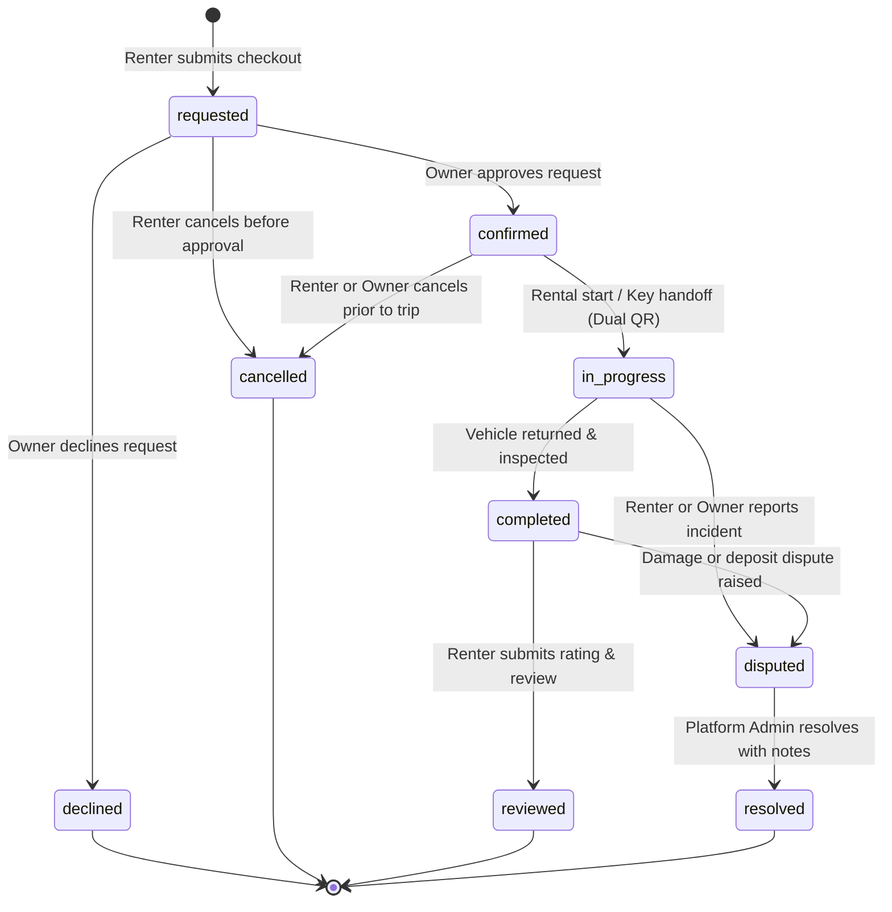

# Shegger Wheels — Booking Lifecycle, Pricing & Escrow Architecture

## 1. Overview
In the Shegger Wheels peer-to-peer car rental platform, bookings represent rental agreements between verified car owners and registered renters across Addis Ababa. This document specifies the booking lifecycle finite state machine (FSM), conflict detection algorithms, price snapshotting guarantees, and the simulated TeleBirr escrow rail.

---

## 2. Booking Finite State Machine (FSM)

The booking lifecycle progresses through strictly validated state transitions. Any mutation attempting an unauthorized transition or illegal actor role is rejected.

### 2.1 State Transition Matrix

| Initial State | Target State | Triggering Actor | Authorization Check | Payment Effect |
|---|---|---|---|---|
| `*` (Checkout) | `requested` | Signed-in Renter | Active session, not suspended, valid future dates, no vehicle conflict. | `held_in_escrow` |
| `requested` | `confirmed` | Vehicle Owner / Admin | `booking.ownerId === actor.userId` or Admin role. | Remaints `held_in_escrow` |
| `requested` | `declined` | Vehicle Owner / Admin | `booking.ownerId === actor.userId` or Admin role. Optional decline reason recorded. | Automatically refunded (`refunded`) |
| `requested` | `cancelled` | Booking Renter / Admin | `booking.renterId === actor.userId` or Admin role. Cancellation reason recorded. | Automatically refunded (`refunded`) |
| `confirmed` | `in_progress` | Renter or Owner / Admin | In-person dual QR handoff confirmation at pickup. | Remaints `held_in_escrow` |
| `confirmed` | `cancelled` | Renter or Owner / Admin | Prior to scheduled handoff. Policy refund executed. | Automatically refunded (`refunded`) |
| `in_progress` | `completed` | Owner or Renter / Admin | Vehicle returned, odometer and fuel level checked. | Disbursed to owner (`paid`) |
| `in_progress` | `disputed` | Renter or Owner / Admin | Incident ticket opened with description and photos. | Remaints `held_in_escrow` pending admin |
| `completed` | `reviewed` | Booking Renter | Renter submits trip rating (1–5) and feedback comment. | Remains `paid` |
| `completed` | `disputed` | Renter or Owner / Admin | Post-trip damage or cleaning dispute filed. | Handled via admin ledger |
| `disputed` | `resolved` | Platform Admin | Admin session active; resolution notes recorded. | Resolved per admin ruling |

---

## 3. Trusted Price Snapshots

To prevent later listing price changes from altering existing bookings:
1. **Server/Storage Authority**: Pricing is computed strictly from trusted vehicle records stored in `localStorage` (`sw_cars_v1`), never from client-submitted query strings or editable DOM inputs.
2. **Immutable Snapshot**: Upon booking creation, `pricePerDay` is captured directly on the `Booking` entity:
   - `pricePerDay`: The agreed daily rate at booking creation.
   - `subtotal`: `days * pricePerDay`.
   - `fee`: 5% marketplace platform fee.
   - `total`: `subtotal + fee + handoverFee + securityDeposit`.
3. If an owner subsequently increases or decreases their vehicle's daily rate, historical and pending bookings retain their original snapshot rate.

---

## 4. Conflict & Availability Detection

A vehicle cannot be double-booked. When a booking request is validated in `checkBookingConflicts()`:
1. **Listing Status Check**: The car must have `status === 'approved'`. Listings marked `draft`, `pending`, `rejected`, or `inactive` cannot be reserved.
2. **Host Blackout Dates**: Checked against `car.unavailableDates[]`. If any day within the requested range `[startDate, endDate)` intersects a blackout date, the booking is rejected.
3. **Active Booking Overlap Check**:
   - Compares the requested range against all bookings where `carId === targetCarId`.
   - Filters only bookings with active reservation statuses: `['requested', 'confirmed', 'in_progress']`. Bookings in terminal states (`declined`, `cancelled`, `resolved`) do NOT block dates.
   - Interval overlap condition: `startDate < existingBooking.endDate && existingBooking.startDate < endDate`.

---

## 5. Simulated TeleBirr Escrow Protocol

### 5.1 Sandbox Scope & Limitations
- **Frontend Prototype Only**: Shegger Wheels simulates the TeleBirr mobile money workflow. No real TeleBirr USSD prompts, API keys, bank accounts, or financial transactions are executed.
- **Client Storage Persistence**: Simulated escrow holds are stored in browser `localStorage` (`sw_bookings_v1`) under `paymentStatus: 'held_in_escrow'`.
- **Payment Reference**: Generated format `TB-MOCK-XXXXXX` mimicking authentic Ethio Telecom SMS confirmation codes.
- **Dual QR Release**: In the simulated workflow, escrow release is held in the municipal vault until in-person vehicle key handoff, protecting both renter and vehicle owner.
