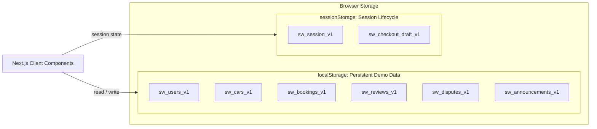

# Shegger Wheels — Data Model & Browser Storage Specification

## 1. Storage Architecture Overview
Shegger Wheels operates as a frontend-only Next.js prototype with zero backend database dependencies. All persistent demo records reside in the browser's `localStorage` using versioned keys (`sw_*_v1`), while temporary session states and in-flight booking summaries reside in `sessionStorage`.



---

## 2. Storage Key Directory

| Storage Key | Storage Mechanism | Schema / Entity | Lifetime & Purge Triggers |
|---|---|---|---|
| `sw_users_v1` | `localStorage` | `User[]` | Persists across sessions. Reset only on user browser clear or `resetDemoData()`. |
| `sw_cars_v1` | `localStorage` | `Car[]` | Persists across sessions. Includes all vehicle listings and owner associations. Baseline seed models auto-merge on update. |
| `sw_bookings_v1` | `localStorage` | `Booking[]` | Persists across sessions. Tracks complete booking lifecycle transitions. |
| `sw_reviews_v1` | `localStorage` | `Review[]` | Persists across sessions. Linked to completed bookings and vehicles. |
| `sw_disputes_v1` | `localStorage` | `Dispute[]` | Persists across sessions. Records disputes opened and resolution notes. |
| `sw_announcements_v1` | `localStorage` | `Announcement[]` | Persists across sessions. Global broadcast announcements. |
| `sw_notifications_v1` | `localStorage` | `Notification[]` | Persists across sessions. User notification alerts for bookings, reviews, and moderation. |
| `sw_session_v1` | `localStorage` (mirrored in `sessionStorage`) | `DemoSession` | Active demo persona session. Persists across reloads/tabs; cleared when user signs out via `clearCurrentSession()`. |
| `sw_checkout_draft_v1` | `localStorage` (mirrored in `sessionStorage`) | `CheckoutDraft` | In-flight date selection and cost calculation; cleared after checkout completion or cancel. |

---

## 3. Data Entities & Schema

### 3.1 User (`sw_users_v1`)
Represents demo platform participants. Accounts can hold multiple roles simultaneously:
```typescript
interface User {
  id: string; // e.g. 'user_owner_01'
  name: string; // e.g. 'Dawit Tadesse'
  email: string; // Unique demo email
  phone: string; // e.g. '+251911223344'
  roles: ('renter' | 'owner' | 'admin')[]; // Coexisting roles allowed (e.g. ['owner', 'renter'])
  status: 'active' | 'suspended'; // Suspended users blocked from demo mutations
  avatarUrl?: string;
  neighbourhood?: string;
  createdAt: string; // ISO date-time
  updatedAt?: string;
}
```

### 3.2 Car (`sw_cars_v1`)
Represents vehicles listed for rental across Addis Ababa sub-cities:
```typescript
interface Car {
  id: string; // e.g. 'car_01'
  ownerId: string; // Foreign key linking to User
  make: string; // e.g. 'Toyota'
  model: string; // e.g. 'RAV4 Hybrid'
  year: number; // e.g. 2022
  transmission: 'Automatic' | 'Manual';
  seats: number; // 4 to 7
  fuelType?: 'Petrol' | 'Diesel' | 'Hybrid' | 'Electric';
  city: 'Addis Ababa';
  neighbourhood: string; // 'Bole', 'Kazanchis', 'CMC', 'Sarbet', etc.
  latitude: number; // Addis coordinate
  longitude: number; // Addis coordinate
  pricePerDay: number; // Daily rental price in ETB
  photos: string[]; // URLs
  featuredImage?: string;
  description: string;
  features: string[]; // Air Conditioning, Bluetooth, etc.
  status: 'draft' | 'pending' | 'approved' | 'rejected' | 'inactive';
  unavailableDates: string[]; // ISO YYYY-MM-DD
  createdAt: string;
}
```

### 3.3 Booking (`sw_bookings_v1`)
Tracks the rental agreement between a renter and an owner:
```typescript
interface Booking {
  id: string; // e.g. 'booking_01'
  carId: string; // Foreign key to Car
  renterId: string; // Foreign key to User
  ownerId: string; // Foreign key to User
  startDate: string; // YYYY-MM-DD
  endDate: string; // YYYY-MM-DD
  days: number;
  pricePerDay: number; // Snapshot of rate agreed at booking time
  subtotal: number; // days * pricePerDay
  fee: number; // Platform fee
  securityDeposit?: number; // Refundable deposit
  total: number; // subtotal + fee + deposit
  paymentStatus: 'unpaid' | 'held_in_escrow' | 'paid' | 'refunded';
  paymentMethod?: string; // 'TeleBirr', 'Chapa', etc.
  paymentReference?: string; // Mock reference (e.g. 'TB-MOCK-994812')
  status: 'requested' | 'confirmed' | 'in_progress' | 'completed' | 'reviewed' | 'declined' | 'cancelled' | 'disputed' | 'resolved';
  declineReason?: string;
  cancellationReason?: string;
  createdAt: string;
  updatedAt: string;
}
```

### 3.4 Review (`sw_reviews_v1`)
Feedback submitted by a renter after a completed rental:
```typescript
interface Review {
  id: string;
  bookingId: string; // One review per eligible booking
  carId: string;
  renterId: string;
  ownerId: string;
  rating: number; // 1 to 5
  comment: string;
  ownerReply?: string; // Host response
  createdAt: string;
}
```

### 3.5 Dispute (`sw_disputes_v1`)
Dispute tickets raised by renters or owners for admin moderation:
```typescript
interface Dispute {
  id: string;
  bookingId: string;
  openedBy: string; // User ID
  openedByRole: 'renter' | 'owner';
  reason: string;
  description: string;
  status: 'open' | 'investigating' | 'resolved';
  resolutionNotes?: string;
  resolvedBy?: string; // Admin user ID
  createdAt: string;
  resolvedAt?: string;
}
```

### 3.6 Announcement (`sw_announcements_v1`)
Broadcast notices managed by the platform administrator:
```typescript
interface Announcement {
  id: string;
  title: string;
  message: string;
  active: boolean;
  category?: 'info' | 'maintenance' | 'feature';
  createdAt: string;
  createdBy: string;
}
```

---

## 4. Seeding & Storage Initialization Rules
- **Non-Destructive Initialization (`initializeDemoData()`)**: On client startup, the system checks whether `sw_users_v1` and `sw_cars_v1` exist in `localStorage`. If already present, it does **not** overwrite or clobber existing data.
- **First-Time Seed**: If records are missing, empty, or corrupt, the application automatically populates realistic initial seed records (`SEED_USERS`, `SEED_CARS`, `SEED_BOOKINGS`, `SEED_REVIEWS`, `SEED_DISPUTES`, `SEED_ANNOUNCEMENTS`).
- **Development Reset (`resetDemoData()`)**: A development control allows developers or demo reviewers to reset all records back to pristine seed data.
- **SSR Safety**: All storage operations explicitly check `isBrowser()` before calling storage APIs, ensuring zero hydration mismatches or node runtime exceptions.

---

## 5. Storage Error Recovery & Graceful Degradation
1. **JSON Parsing Protection**: Every `readStorage()` call is wrapped in a `try...catch` block. Malformed JSON returns the default fallback safely.
2. **Schema Type Guards**: Type validator predicates inspect parsed objects. If corrupted data is detected, the getter logs a warning and falls back to clean seed data.
3. **Storage Quota Handling**: `writeStorage()` catches `QuotaExceededError` or DOM exceptions (common in strict private/incognito browsing) and returns `false` without crashing the UI.

---

## 6. Inherent Limitations of Browser-Only Persistence
- **Client-Side Isolated**: Storage is confined to the individual browser profile/origin. Data does not synchronize across separate machines or private browsing tabs.
- **User Modifiable**: `localStorage` is technically accessible via browser DevTools; hence, frontend checks demonstrate system architecture rather than production security.
- **Simulated Transactions**: Financial transactions (TeleBirr, Chapa) and GPS tracking coordinates are strictly simulated without external financial or telematics APIs.

---

## 7. Client Data Layer — SWR Queries, Keys & Invalidation Rules

Shegger Wheels employs **SWR** (`swr@^2.5.1`) for reactive state management, caching, deduplication, and zero-latency cross-tab synchronization.

### 7.1 SWR Query Registry

| Query Key | Hook | Default Deduping / Refresh Rule | One-Line Architectural Rationale |
|---|---|---|---|
| `'shegger:cars'` | `useCars(config?)` | `dedupingInterval: 3,600,000` (1 hr), `revalidateOnFocus: true` | Prevents redundant fleet recalculations while ensuring catalog refreshes if an admin or host adds a car in another tab. |
| `'shegger:car:${id}'` | `useCar(id, config?)` | Conditional key (`null` when ID missing), `fallbackData: seed` | Eliminates first-paint spinner and avoids executing queries for unselected vehicle routes. |
| `'shegger:bookings'` | `useBookings(config?)` | `dedupingInterval: 3,600,000` (1 hr), `keepPreviousData: true` | Provides immediate KPI counts in host/renter dashboards without screen flickering between state transitions. |
| `'shegger:booking:${id}'` | `useBooking(id, config?)` | `refreshInterval: 5000` when trip is active (`in_progress`) | Automatically polls live trip telemetry and waypoint checkpoints every 5 seconds without manual `setInterval` boilerplate. |
| `'shegger:reviews'` | `useReviews()` | `dedupingInterval: 3,600,000` (1 hr), `revalidateOnFocus: true` | Caches public vehicle ratings and updates across all vehicle cards immediately upon new review submission. |
| `'shegger:reviews:${carId}'` | `useCarReviews(carId)` | Conditional key (`null` when `carId` missing) | Isolates reviews to the active vehicle details page, preventing unnecessary queries for unrelated cars. |
| `'shegger:disputes'` | `useDisputes()` | `dedupingInterval: 3,600,000` (1 hr), `revalidateOnFocus: true` | Keeps admin mediation queues synchronized without high polling overhead. |
| `'shegger:dispute:${id}'` | `useDispute(id)` | Conditional key (`null` when ID missing) | Loads single dispute record for modal inspection without fetching unrelated ledger rows. |
| `'shegger:notifications:${userId}'` | `useNotifications(userId)` | Conditional key (`null` when logged out), `revalidateOnFocus: true` | Enforces tenant privacy by fetching alerts only for the active user ID and clears immediately on sign-out. |
| `'shegger:session'` | `useSession()` | `revalidateOnFocus: true`, `fallbackData: getCurrentSession()` | Synchronizes authenticated persona and role switches instantaneously across open tabs via `BroadcastChannel`. |
| `'shegger:users'` | `useUsers()` | `dedupingInterval: 3,600,000` (1 hr), `revalidateOnFocus: true` | Caches directory of Addis Ababa demo personas for role switches and dashboard lookups. |

### 7.2 Core Data Fetching Patterns Applied

1. **Stale-While-Revalidate (SWR)**:
   - On first render, components render cached/seed data immediately via `fallbackData`, eliminating initial loading spinners.
   - Background revalidation checks `localStorage` and smoothly updates the UI if values have changed.
2. **Conditional Fetching (`null` keys)**:
   - Hooks never execute under conditional `if` blocks. When an entity ID or session user is not available, `null` is passed as the SWR key to safely suspend execution without violating the Rules of Hooks.
3. **Optimistic Updates & Mutation (`mutate`)**:
   - Write operations (e.g. creating bookings, adding listings, submitting reviews) persist changes directly to `localStorage` and trigger `mutate('shegger:*')`.
4. **Cross-Tab Synchronization (`BroadcastChannel`)**:
   - Modern browsers broadcast state mutations via `new BroadcastChannel('shegger_wheels_sync')`, ensuring that if an admin approves a listing or a renter books a vehicle in Tab 1, Tab 2's SWR cache revalidates and reflects the update instantly.
5. **Debouncing & `keepPreviousData`**:
   - In `/cars`, search inputs and filter changes use `keepPreviousData: true`, preventing the fleet grid from flashing empty while typing a search query.

