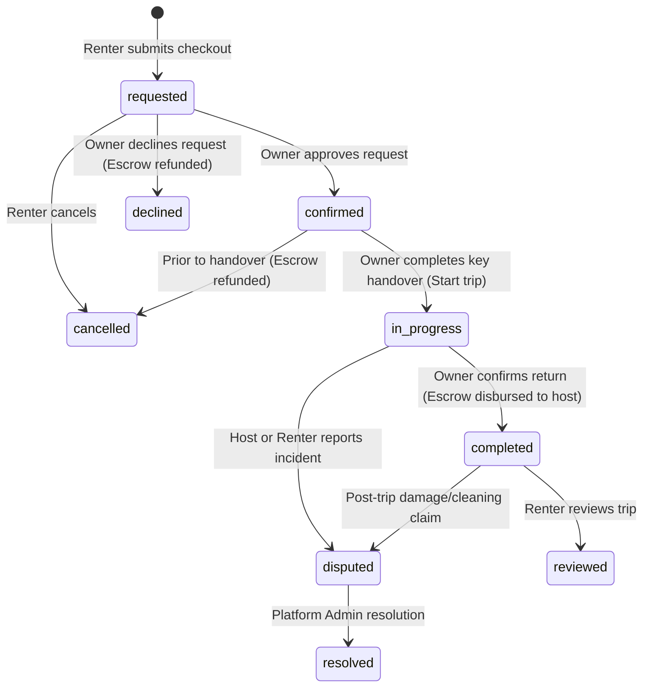

# Shegger Wheels — Owner Booking Management & Earnings Architecture

## 1. Overview
The Owner Booking Management and Earnings engine enables verified car owners in Addis Ababa to review incoming rental requests, execute lifecycle status transitions (handover, return completion, and disputes), and monitor their simulated TeleBirr escrow payouts.

This document details the owner permissions matrix, booking decision workflows, availability conflict guards, and earnings analytics calculations.

---

## 2. Owner Booking Decision Matrix & Lifecycle FSM

All rental agreements transition through the Shegger Wheels finite state machine (FSM). Host operations strictly adhere to authorized transitions:

### 2.1 Allowed Host Operations

| Current Status | Target Status | Host Operation | Preconditions & Security Checks | Financial / Escrow Effect |
|---|---|---|---|---|
| `requested` | `confirmed` | **Confirm Request** | Owner session active; account not suspended; caller owns vehicle (`booking.ownerId === actor.userId`); no blackout or overlapping booking conflict. | Escrow remains `held_in_escrow`. |
| `requested` | `declined` | **Decline Request** | Caller owns vehicle; decline reason recorded. | Mock escrow automatically refunded (`refunded`). |
| `confirmed` | `in_progress` | **Start Rental (Handover)** | Driver license verified; odometer & fuel checked; keys handed over. | Escrow remains `held_in_escrow`. |
| `in_progress` | `completed` | **Complete Rental (Return)** | Vehicle returned; drop-off inspection passed; fuel level verified. | Escrow disbursed to host wallet (`paid`). |
| `in_progress` \| `completed` | `disputed` | **Report Incident / Dispute** | Description of damage or dispute provided (min 5 chars). | Escrow frozen in `held_in_escrow` pending admin review. |

### 2.2 Strict Boundary Rules
- **No Self-Approval of Listings**: Handled separately in `lib/fleet.ts` (moderation remains an administrative function).
- **No Cross-User Actions**: Owner A cannot view, approve, decline, or complete bookings belonging to Owner B's vehicles.
- **No Unauthorized Cancellations**: Owners cannot cancel trips after key handover has taken place.
- **Renter-Only Actions Preserved**: Owners cannot submit trip reviews on behalf of renters.

---

## 3. Stale Reservation & Availability Conflict Prevention

When an owner attempts to approve an incoming request (`requested` → `confirmed`):
1. **Blackout Interception**: `checkBookingConflicts` in `lib/bookings.ts` inspects the vehicle's `car.unavailableDates`. If the owner previously blocked any day within `[startDate, endDate)`, confirmation is rejected:
   > *"Cannot confirm reservation: The vehicle is no longer available for these dates due to a blackout date or overlapping booking."*
2. **Overlapping Booking Interception**: If another booking for the same vehicle was confirmed in the meantime, the second confirmation is blocked.
3. **Vehicle Listing Status**: If the vehicle listing was paused (`inactive`) or rejected, confirmation is prevented.

---

## 4. Earnings & Financial Analytics

### 4.1 Financial Ledger Terminology & Calculations

Shegger Wheels maintains a transparent distinction between completed payouts and in-transit escrow:

| Metric | Calculation | Included Bookings | Description |
|---|---|---|---|
| **Completed Payouts** | $\sum \text{subtotal}$ | `status IN ('completed', 'reviewed') AND paymentStatus == 'paid'` | Net rental income disbursed to the host's simulated TeleBirr wallet upon successful return inspection. |
| **Escrow in Transit** | $\sum \text{subtotal}$ | `paymentStatus == 'held_in_escrow' AND status NOT IN ('cancelled', 'declined')` | Funds securely held for active on-road rentals, confirmed upcoming trips, or unreviewed requests. |
| **Refunded / Lost Revenue** | $\sum \text{subtotal}$ | `status IN ('cancelled', 'declined')` | Bookings that were declined by host or cancelled prior to handover. |
| **Days Booked** | $\sum \text{days}$ | Completed rentals | Cumulative utilization output across all registered vehicles. |

> **Important Guarantee:** In-transit or held-in-escrow funds are never counted as completed earnings until vehicle return is verified.

### 4.2 Per-Vehicle Utilization Analytics
For each vehicle in the owner's fleet, the engine computes:
- Total bookings received
- Days rented / utilized
- Net revenue generated (ETB)
- Active reservation status (e.g. `Active On Road`, `Confirmed Upcoming`, `Available`)

---

## 5. Security & Session Verification

Every operation in `lib/bookings.ts` enforces four security layers:
1. **Session Barrier**: `getCurrentSession()` must match `actor.userId`.
2. **Suspension Check**: Suspended accounts cannot confirm, decline, start, or complete bookings.
3. **Role Validation**: Actor must possess the `owner` (or `admin`) role.
4. **Ownership Verification**: `booking.ownerId === actor.userId` is checked inside the mutation logic, not merely hidden in the UI.

---

## 6. Storage Reactivity

When an owner confirms, declines, or completes a reservation, `saveBooking` dispatches custom browser events:
- `shegger-storage-change`
- `shegger-session-change`

The `/dashboard/host` hub subscribes via React 19's `useSyncExternalStore` with cached snapshot references, instantly refreshing KPI counters, reservation lists, and financial analytics without page reloads.
