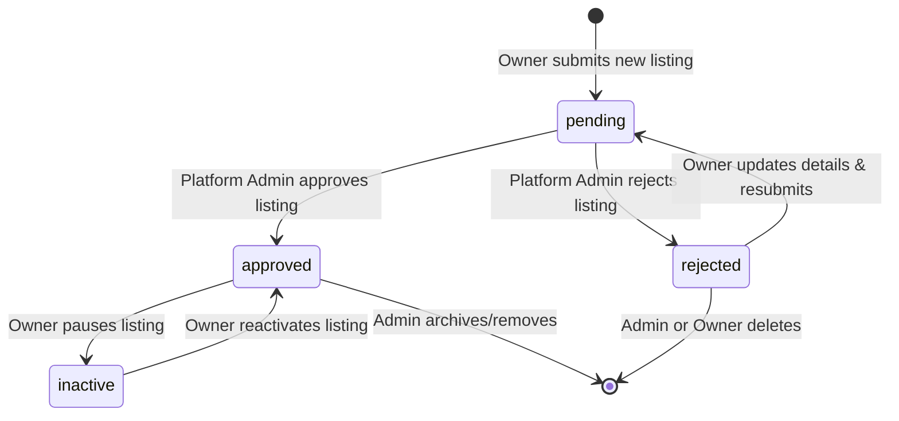

# Shegger Wheels — Owner Fleet & Vehicle Listing Architecture

## 1. Overview
The Owner Fleet management system enables verified car owners in Addis Ababa to list their vehicles on the Shegger Wheels peer-to-peer mobility marketplace, manage listing publication states, and configure vehicle blackout dates.

This document specifies the listing lifecycle, moderation requirements, authorization guards, calendar availability mechanisms, and pricing snapshot preservation.

---

## 2. Listing Lifecycle & Moderation States

All vehicle listings exist in one of four states within the `CarStatus` finite state machine:

### 2.1 State Matrix & Permissions

| Status | Description | Public Search Visibility | Can Receive Bookings | Allowed Actor Mutations |
|---|---|---|---|---|
| `pending` | Newly created listing undergoing administrative review. | Hidden | No | Owner may edit details; Admin may approve or reject. |
| `approved` | Verified by platform admin; active for public booking. | Visible | Yes (subject to blackout dates) | Owner may edit details, pause (`inactive`), or manage blackout dates. |
| `inactive` | Paused temporarily by owner (e.g. personal use or maintenance). | Hidden | No | Owner may reactivate (`approved`) or edit details. |
| `rejected` | Listing declined during administrative moderation. | Hidden | No | Owner may modify specs and resubmit; Admin may re-evaluate. |

### 2.2 Strict Self-Approval Prevention
- **Security Rule**: Owners are strictly prohibited from approving their own listings.
- In `lib/fleet.ts` (`updateCarListing`), any request from a non-admin attempting to transition a car with `status: 'pending'` or `status: 'rejected'` into `status: 'approved'` is rejected with an explicit error:
  > *"Owners cannot self-approve vehicle listings. Moderation must be performed by a platform administrator."*
- Owners may only toggle between `approved` and `inactive` (pausing/resuming an already-approved car).

---

## 3. Listing Creation & Field Validations

Vehicle creation is handled by `createCarListing(actor, input)` in `lib/fleet.ts`.

### 3.1 Field-Level Validation Constraints

| Field | Type | Validation Rules | Default / Source |
|---|---|---|---|
| `ownerId` | `string` | **Derived strictly from authenticated session.** Never accepted from client input. | `session.userId` |
| `make` | `string` | Required, trimmed, minimum 2 characters. | User Input |
| `model` | `string` | Required, trimmed, non-empty. | User Input |
| `year` | `number` | Required integer between `1995` and `currentYear + 1`. | User Input |
| `transmission` | `'Automatic' \| 'Manual'` | Required enum value. | User Input |
| `seats` | `number` | Required integer between `2` and `16`. | User Input |
| `fuelType` | `enum` | `'Petrol' \| 'Diesel' \| 'Hybrid' \| 'Electric'`. | Defaults to `'Petrol'` |
| `city` | `'Addis Ababa'` | Fixed marketplace scope. | Fixed `'Addis Ababa'` |
| `neighbourhood` | `string` | Must be an established Addis Ababa neighbourhood (Bole, Kazanchis, CMC, Sarbet, Old Airport, Piassa, Lideta, Mexico, Gerji, Megenagna, Bisrate Gabriel). | Automatically sets `latitude` and `longitude`. |
| `pricePerDay` | `number` | Integer rate $\ge 500$ ETB/day. | User Input |
| `description` | `string` | Required, minimum 10 characters. | User Input |
| `features` | `string[]` | Array of strings, minimum 1 feature selected. | User Input |
| `photos` | `string[]` | Array of photo URLs, minimum 1 photo required. | Preset selector or custom URL |
| `status` | `'pending'` | **Always begins as `'pending'`.** | Hardcoded initial state |
| `unavailableDates` | `string[]` | Initialized as empty array `[]`. | Hardcoded initial state |

---

## 4. Owner Authorization & Mutation Boundaries

Every mutation function in `lib/fleet.ts` strictly validates authorization before modifying storage:

1. **Active Session Requirement**:
   - `getCurrentSession()` must return a valid session.
   - `session.userId` must match the caller's actor `userId`.
2. **Account Suspension Check**:
   - User account is queried from `sw_users_v1`.
   - If `user.status === 'suspended'`, all mutations are rejected.
3. **Owner Role Verification**:
   - For listing creation, `user.roles.includes('owner')` must be true.
4. **Ownership Verification (Cross-User Barrier)**:
   - For listing updates, toggling status, or managing blackout dates, `car.ownerId === actor.userId` is strictly enforced.
   - Cross-user tampering (Owner A modifying Owner B's vehicle) returns:
     > *"Unauthorized: You do not own this vehicle listing."*
   - Platform admins (`actor.role === 'admin'`) retain overriding maintenance permissions.

---

## 5. Blackout Dates & Availability Engine

Owners manage vehicle availability via `car.unavailableDates: string[]`.

### 5.1 Blackout Date Validation (`updateCarBlackoutDates`)
- Date format must strictly match `YYYY-MM-DD`.
- Dates cannot be in the past (`d < todayStr`).
- Duplicates are eliminated and dates are stored in chronological ascending order.

### 5.2 Calendar & Booking Integration
When a renter attempts to book a vehicle via `checkCarAvailability` (`lib/bookings.ts`):
1. **Status Barrier**: If `car.status !== 'approved'`, booking is rejected immediately.
2. **Blackout Interception**: If any date in `[startDate, endDate)` matches a date in `car.unavailableDates`, the engine rejects the booking with:
   > *"The vehicle has been marked unavailable by the host on [formatted date]."*
3. **Overlapping Booking Check**: If another active reservation overlaps, the booking is rejected.

---

## 6. Price Snapshot Preservation

When an owner updates a listing's daily rate (`pricePerDay`), existing and historical bookings remain unaltered:
1. Bookings store an immutable snapshot of `pricePerDay`, `subtotal`, `fee`, and `total` upon creation.
2. The booking engine never re-evaluates past booking totals from current car rates.
3. Historical billing and renter escrow records remain 100% stable.

---

## 7. Storage Reactivity

Updates dispatched by `saveCar` in `lib/storage.ts` emit custom browser events:
- `shegger-storage-change`
- `shegger-session-change`

The `/dashboard/host` view connects via React 19's `useSyncExternalStore`, instantly synchronizing UI state, metrics counters, and listing cards without requiring page reloads or polling.
