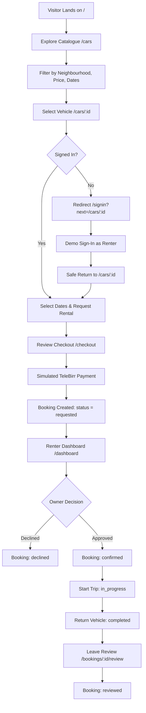
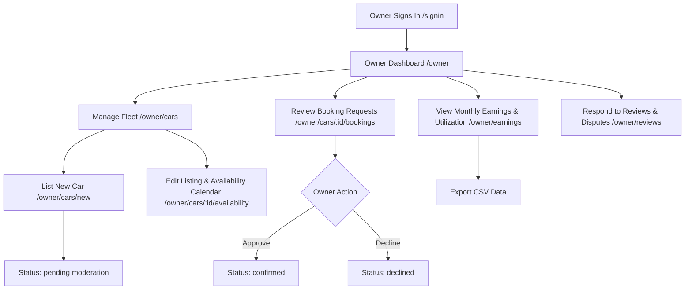
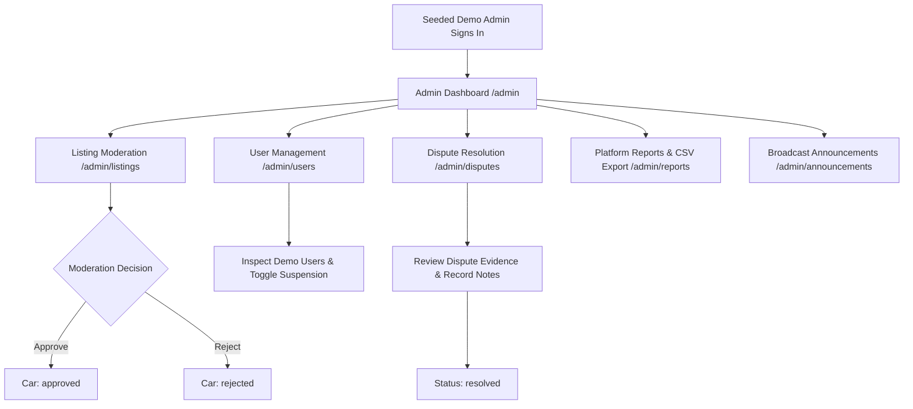
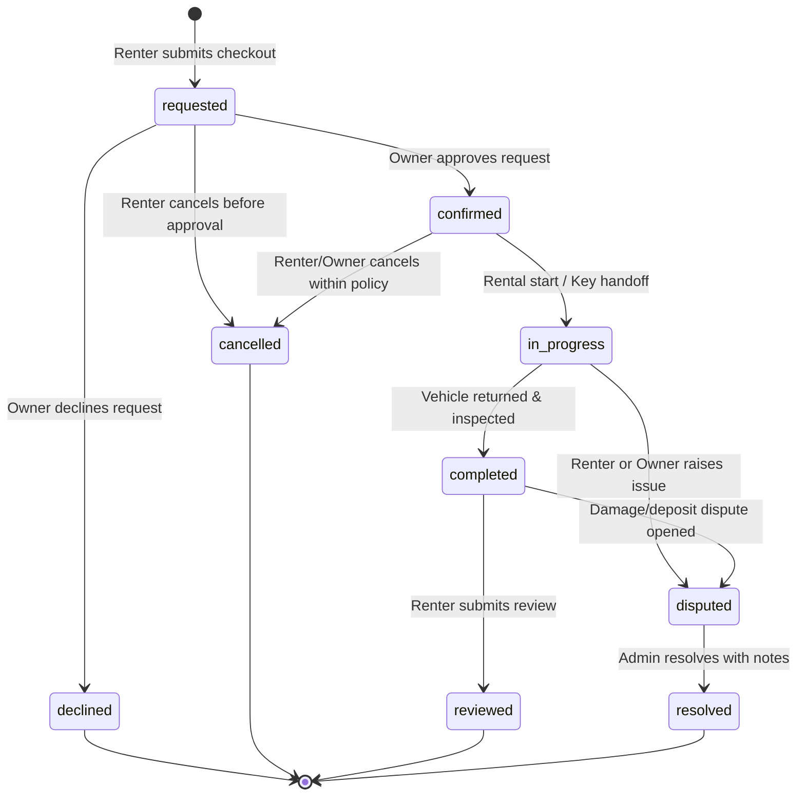

# Shegger Wheels — User Flows & Booking Lifecycle

## 1. Actor Journeys

### 1.1 Visitor & Renter Journey

1. **Discovery & Exploration**: Visitor arrives at `/` (landing page), clicks "Explore Cars", and searches the fleet at `/cars` using neighbourhood chips (Bole, Kazanchis, etc.), transmission filters, and price ranges.
2. **Vehicle Inspection**: Visitor views `/cars/[id]` with high-res photos, host details, specifications, and availability calendar.
3. **Session Interception**: Clicking "Request Rental" when signed out safely redirects to `/signin?next=/cars/[id]`. Upon selecting a demo account, the user is safely returned to `/cars/[id]`.
4. **Mock Checkout**: Dates and daily rate are reviewed on `/checkout`. User initiates mock TeleBirr escrow payment.
5. **Trip Lifecycle**:
   - Status starts as `requested`.
   - Once the owner approves, status becomes `confirmed`.
   - When pickup occurs, rental moves to `in_progress` (eligible for simulated tracking at `/bookings/[id]/track`).
   - Vehicle return marks status as `completed`.
   - Renter submits rating and feedback, advancing status to `reviewed`.

---

### 1.2 Car Owner Journey

1. **Fleet Onboarding**: Car owner navigates to `/owner/cars/new` to provide vehicle specifications, daily rental price (in ETB), photos, and sub-city location. The listing is submitted as `pending` for admin review.
2. **Availability & Pricing**: The owner sets blackout dates for personal vehicle usage or maintenance via `/owner/cars/[id]/availability`.
3. **Request Triage**: The owner reviews incoming booking requests. Owner can **Approve** (transitioning booking to `confirmed`) or **Decline** with an optional note.
4. **Fleet Analytics & Feedback**: The owner monitors utilization rates and monthly earnings in ETB at `/owner/earnings`, and replies to renter reviews at `/owner/reviews`.

---

### 1.3 Platform Administrator Journey

1. **Listing Moderation**: Admin inspects newly submitted owner vehicles at `/admin/listings` and marks them `approved` or `rejected`. Only `approved` vehicles appear in public catalogue.
2. **User Governance**: Admin views all platform users at `/admin/users`. Admin can suspend abusive accounts (`status: suspended`), immediately blocking them from executing demo actions.
3. **Dispute Resolution**: Admin reviews open dispute tickets at `/admin/disputes/[id]`, adds resolution notes, and transitions the dispute to `resolved`.
4. **Platform Operations**: Admin inspects system-wide booking activity, monitors mock escrow commissions, exports report CSVs, and publishes global system announcements.

---

## 2. Booking Finite State Machine (FSM)

The booking lifecycle is strictly modeled as a finite set of valid transitions. Any mutation attempting an unauthorized transition is rejected by frontend guardrails.

### 2.1 State Transition Matrix

| Initial State | Target State | Triggering Action | Allowed Actor | Guard / Condition |
|---|---|---|---|---|
| `*` | `requested` | Submit checkout draft | Signed-in Renter | Valid dates, no overlaps, active car listing. |
| `requested` | `confirmed` | Approve booking | Vehicle Owner | Owner owns the car; payment held in mock escrow. |
| `requested` | `declined` | Decline booking | Vehicle Owner | Owner owns the car. Terminal state for this request. |
| `requested` | `cancelled` | Cancel request | Booking Renter | Renter owns the booking. |
| `confirmed` | `in_progress` | Start rental / Check-in | Renter or Owner | Rental start date reached; keys handed over. |
| `confirmed` | `cancelled` | Cancel confirmed trip | Renter or Owner | Before trip start; triggers mock escrow refund. |
| `in_progress` | `completed` | Return vehicle | Vehicle Owner / Renter | Vehicle returned and inspected. |
| `in_progress` | `disputed` | Raise dispute ticket | Renter or Owner | Booking is active; incident reason provided. |
| `completed` | `reviewed` | Submit review | Booking Renter | Renter has not yet reviewed this booking. |
| `completed` | `disputed` | File post-trip issue | Renter or Owner | Deposit or post-trip damage reported. |
| `disputed` | `resolved` | Resolve dispute | Platform Admin | Admin session active; resolution notes recorded. |

---

## 3. Session & Ownership Guardrails

Every protected mutation in Shegger Wheels checks four boundaries before writing to `localStorage`:
1. **Session Presence**: Active session exists in `sessionStorage` (`sw_session_v1`).
2. **Account Status**: User is not `suspended`.
3. **Role Authorization**: User roles array contains the required role (`renter`, `owner`, or `admin`).
4. **Record Ownership**: The target entity (`booking.renterId === session.userId` or `car.ownerId === session.userId`), unless the actor is `admin`.
